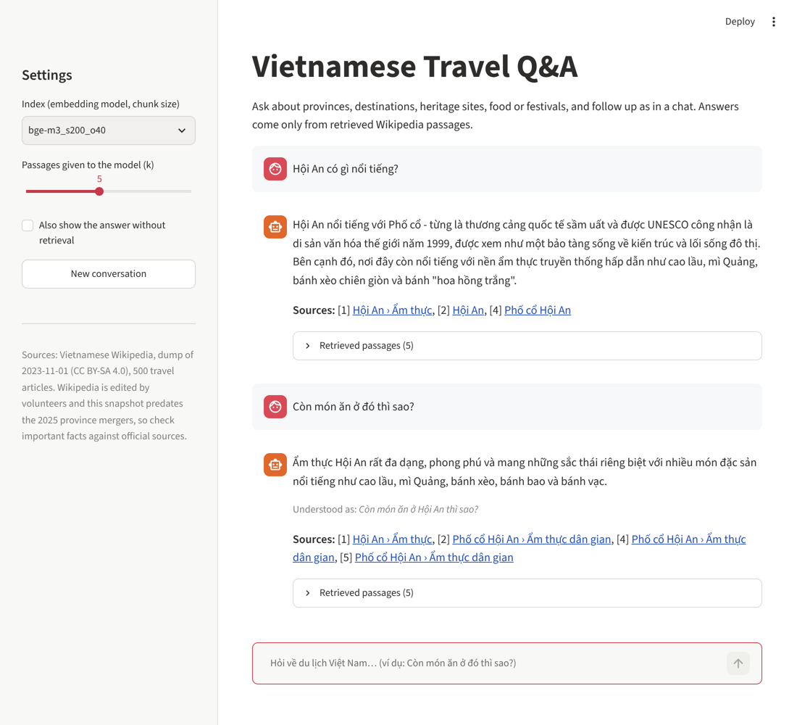

# Vietnamese Travel RAG

Retrieval-augmented question answering over Vietnamese Wikipedia articles about
provinces, destinations, heritage sites, food and festivals, with cited source
passages. Work in progress.

## Status

| Step | State |
|---|---|
| Data selection (500 articles) and chunking | done |
| Embeddings + FAISS retrieval | done |
| Answer generation with citations (Gemini) | done |
| Evaluation set (140 questions after review + 20 unanswerable) | done |
| Retrieval / answer / multi-turn evaluation | done |
| Streamlit demo | done |

## Data

* Source: [`wikimedia/wikipedia`](https://huggingface.co/datasets/wikimedia/wikipedia),
  config `20231101.vi` (Vietnamese Wikipedia dump of 2023-11-01).
* License: text is CC BY-SA 4.0. Every chunk keeps the URL of its article so
  answers can attribute the source.
* The dump predates the 2025 province mergers, so it describes the 63-province map.
* Selection (`src/travel_rag/select_articles.py`) is rule-based because the dump
  has no categories: the 63 provinces, a curated list of well-known places,
  dishes and festivals, and prefix-matched titles ("Vịnh ", "Chùa ", "Bánh ",
  "Lễ hội ", ...) filtered by their lead section. Result: 63 provinces,
  160 destinations, 135 heritage sites, 85 dishes, 57 festivals.
  The rules still let some loosely related pages through; this is a known limitation.

## Chunking

`src/travel_rag/chunking.py` splits each article into section-aware,
sentence-aligned chunks with sentence-level overlap, measured in
whitespace-separated words (Vietnamese syllables). Reference sections are dropped.

| chunk size / overlap (words) | chunks | mean words |
|---|---|---|
| 100 / 20 | 18,469 | 75.3 |
| 200 / 40 | 10,393 | 138.4 |
| 400 / 80 | 6,968 | 204.2 |

## Retrieval

* Embedding model: [`BAAI/bge-m3`](https://huggingface.co/BAAI/bge-m3)
  (multilingual, 1024 dims). Each chunk is embedded as `title — section` plus
  its text; vectors are L2-normalised so inner product = cosine similarity.
* Index: FAISS `IndexFlatIP` (exact search). At ~10k vectors a brute-force
  scan takes milliseconds, so an approximate index (HNSW/IVF) is unnecessary.
* CPU embedding speed, measured on 128 sampled chunks with 4 threads
  (`scripts/benchmark_embedders.py`, `results/embedding_benchmark.json`):

| model | dim | chunks/s | est. time for 10,393 chunks |
|---|---|---|---|
| BAAI/bge-m3 | 1024 | 2.97 | ~58 min (actual full run: 55.5 min) |
| intfloat/multilingual-e5-base | 768 | 10.34 | ~17 min |
| intfloat/multilingual-e5-small | 384 | 36.54 | ~5 min (actual full run: 5.6 min) |

  bge-m3 is used for the main index. Because it is ~12x slower than
  multilingual-e5-small on CPU, the chunk-size comparison is run with
  e5-small, and the two models are compared at the default chunk size.
* Chunks average ~1.23 tokens per word with these tokenizers
  (median 204 tokens for 166 words), well under the 512-token cap.

```bash
PYTHONPATH=src python -m travel_rag.build_index --size 200 --overlap 40 --model BAAI/bge-m3
PYTHONPATH=src python -m travel_rag.search "Phở có nguồn gốc từ đâu?" --k 5
```

## Answer generation

`src/travel_rag/rag.py` sends the top-k chunks as numbered sources to Gemini
(`gemini-flash-lite-latest`, temperature 0) with a JSON response schema
`{found, answer, citations}`. Hallucination controls:

* answer only from the sources; outside knowledge is forbidden;
* explicit abstention: `found=false` becomes the fixed string
  `Không có trong tài liệu.` so abstention can be measured;
* citation numbers outside `1..k` are dropped and counted; kept ones map to the
  chunk id and Wikipedia URL;
* the sources are a November 2023 snapshot, so answers about "now" must state
  the time the source describes;
* source text is treated as data, not instructions.

The client (`src/travel_rag/llm.py`) retries 429/5xx with exponential backoff
and caches responses on disk, so evaluation reruns are repeatable and free.

Observed on a few hand-picked questions (not a measurement; see Evaluation):

| question | RAG | no RAG |
|---|---|---|
| Fansipan cao bao nhiêu mét? | 3147,3 m, cited | 3.147 m |
| Giá vé tham quan Vịnh Hạ Long năm 2024? | `Không có trong tài liệu.` | invents specific 2024 prices |
| Ai là huấn luyện viên đội tuyển bóng đá Việt Nam? | 2012 coach from a city article, flagged as dated; one citation does not support the claim | current coach |

The last row shows two failure modes the evaluation has to measure: stale
sources and citations that do not support the claim.

```bash
PYTHONPATH=src python -m travel_rag.ask "Phở có nguồn gốc từ đâu?" --closed-book
```

## Evaluation set

* `eval/qa.jsonl`: 147 questions generated by `gemini-flash-lite-latest` from
  147 different articles (`src/travel_rag/make_eval_set.py`). Sampling is
  stratified by category (30 provinces, 40 destinations, 34 heritage,
  23 food, 20 festivals), one chunk per article, fixed seed.
* Each item stores the question, a short answer and an **evidence span
  copied verbatim from the source chunk**. The copy is verified in code; an
  item whose evidence does not occur in the chunk is discarded. Storing the
  evidence text (not only a chunk id) lets the gold passage be found again
  when the corpus is re-chunked at another size.
* Generation log (`eval/qa_generation_summary.json`): 180 chunks tried,
  33 marked unusable by the model (lists, fragments), 147 kept, 0 rejected
  for non-verbatim evidence.
* `eval/unanswerable.jsonl`: 20 hand-written questions the corpus cannot
  answer (2024–2026 prices and schedules, current conditions, personal
  recommendations, made-up places, off-topic), to measure abstention.
* Human review of a stratified sample of 50 items (guide in
  `eval/review/REVIEW_GUIDE.md`, labels in `eval/review/review_50_labels.jsonl`):
  33 ok (66%), 14 fix, 2 drop, 1 left blank. The reviewer is not a
  historian or a travel specialist, so the review judges *item quality against
  its evidence* (natural, self-contained question; answer supported by the
  evidence; relevant to travel), which needs reading skill, not domain
  knowledge. It is not a check of historical accuracy; that is what the
  source-based fact check below is for, and it is limited to what public
  sources say. So roughly a third of
  LLM-generated items needed a human change; the 97 unreviewed items likely have
  similar problems, which is why results are also reported on the reviewed
  subset. The reviewer saw the web fact check while labelling, so the two
  labels are not independent.
* Resolutions (`eval/review/resolutions.json`, applied by
  `scripts/apply_review.py`): a gold answer must be supported by the corpus
  evidence. Fixes that stay within the evidence were applied (5 items,
  including q036 whose question mixed up the pass and the road); items
  that were off-topic, outdated, trivia, unverifiable, or whose requested
  correction went beyond the evidence were dropped (7 items: q003, q019, q074,
  q083, q111, q122, q139).
  Items whose source is wrong or disputed are kept, flagged in `fact_status`.
* Final set `eval/qa_final.jsonl`: 140 questions, of which 44 human-reviewed;
  29 of those 44 are also supported by an independent source.
* Fact check beyond Wikipedia. Wikipedia is crowd-edited, so the 50 reviewed
  items were also checked against independent web sources, excluding Wikipedia
  and its mirrors (`eval/review/fact_check_web.jsonl`, one row per item with
  source URLs and a note). This is a separate question from the review label:
  the review asks whether the item is a good test of the system *given its
  sources*; the fact check asks whether the source itself is right.
  Result (web search plus LLM reading; a second, wider search was run on
  items where the first one was thin): 30 supported, 4 supported only by
  pages that copy Wikipedia, 6 sources disagree, 4 contradicted by an
  official source, 6 no independent source. The contradicted items are q032
  (recognition decision 2017, not the 2018 ceremony date), q083 (the site was
  inhabited in 1895), q123 (2–3 rice crops a year, not 1) and q089 (facade
  bricks from Marseille per VOV and a brick stamp; Wikipedia says Toulouse in
  one section and Marseille in another). The second search also changed q035
  from supported to disputed: "Ban-Mé-Thuot" already appears in French
  documents from 1901. A wider search changing 2 of 50 verdicts shows that a
  single search pass is not a reliable fact check.
* Known bias: questions written from a single chunk reuse its wording
  (on average 49% of question words also appear in the evidence), which makes
  retrieval easier than for real user questions. Scores on this set are
  therefore an optimistic estimate.
* Evidence spans are short excerpts of Vietnamese Wikipedia (CC BY-SA 4.0);
  each item keeps its article URL.

## Evaluation: retrieval

`src/travel_rag/eval_retrieval.py`, 140 questions (44 human-reviewed).
A chunk is relevant if it is from the right article and contains the gold
evidence span (1 of 140 items needed a word-overlap fallback with 100-word
chunks). recall@k = share of questions with a relevant chunk in the top k;
MRR@10 = mean of 1/rank of the first relevant chunk. Brackets are 95%
bootstrap intervals over questions.

| retriever, chunk size / overlap | chunks | R@1 | R@5 | R@10 | MRR@10 | reviewed R@5 / MRR |
|---|---|---|---|---|---|---|
| e5-small, 100/20 | 18,469 | 0.714 | 0.943 [0.90–0.98] | 0.957 | 0.817 [0.76–0.87] | 0.977 / 0.828 |
| e5-small, 200/40 | 10,393 | 0.664 | 0.936 [0.89–0.97] | 0.964 | 0.783 [0.73–0.83] | 0.955 / 0.824 |
| e5-small, 400/80 | 6,968 | 0.621 | 0.929 [0.89–0.96] | 0.957 | 0.750 [0.69–0.81] | 0.955 / 0.817 |
| bge-m3, 200/40 | 10,393 | 0.786 | 0.957 [0.92–0.99] | 0.993 | 0.868 [0.82–0.91] | 1.000 / 0.903 |
| BM25, 200/40 | 10,393 | 0.700 | 0.893 [0.84–0.94] | 0.943 | 0.785 [0.72–0.84] | 0.909 / 0.804 |

Paired differences (same questions resampled for both systems):

| comparison | ΔMRR@10 | ΔR@5 |
|---|---|---|
| bge-m3 − e5-small (200/40) | +0.085 [+0.035, +0.134] | +0.021 [-0.021, +0.064] |
| bge-m3 − BM25 (200/40) | +0.082 [+0.025, +0.139] | +0.064 [+0.007, +0.114] |
| e5-small − BM25 (200/40) | -0.002 [-0.057, +0.053] | +0.043 [+0.007, +0.086] |
| e5-small 100/20 − 400/80 | +0.068 [+0.016, +0.121] | +0.014 [-0.029, +0.057] |

What the numbers support:

* bge-m3 ranks the right chunk higher than e5-small (MRR +0.085, interval
  excludes 0). At R@5 the two are within noise; most of bge-m3's gain is in
  putting the gold chunk first.
* BM25, a keyword baseline, matches e5-small on MRR. This is the expected
  effect of generated questions reusing words from their source chunk, so
  these absolute scores overstate performance on real user questions.
* Smaller chunks rank the gold chunk higher (100 vs 400 words: MRR +0.068),
  but recall@5 is flat, and 5 small chunks give the generator 4x less text than
  5 large ones. The questions were also written from 200-word chunks. So this
  is not a reason to switch to 100-word chunks without an answer-level test.
* The 44 reviewed items score a bit higher than the full set; with 44 items
  the difference is within noise.

## Evaluation: answers

`src/travel_rag/eval_answers.py`. Generator `gemini-flash-lite-latest`
(temperature 0) with bge-m3 / 200-word chunks / k=5, versus the same model
without retrieval. Judge: `gemini-3.1-flash-lite`, a different release from the
generator, given the question, reference answer, evidence and candidate
answer, and told not to use its own knowledge. Accuracy = share judged
"correct"; brackets are 95% bootstrap intervals.

| subset | n | RAG accuracy | no-RAG accuracy | no-RAG incorrect | no-RAG abstained |
|---|---|---|---|---|---|
| all questions | 140 | 93.6% [89.3–97.1] | 41.4% [33.6–50.0] | 45.0% | 7.1% |
| human-reviewed | 44 | 93.2% [84.1–100.0] | 47.7% [34.1–61.4] | 38.6% | 9.1% |
| reviewed and fact-checked | 29 | 96.6% [89.7–100.0] | 55.2% [37.9–72.4] | 34.5% | 6.9% |

* Paired on the same 140 questions: RAG correct and no-RAG wrong 75,
  the reverse 2, both correct 56, neither 7.
* Without retrieval the model answers wrongly far more often than it declines
  (45% incorrect vs 7% "Tôi không biết").
* Unanswerable questions (n=20): RAG abstained 95%,
  no-RAG 15%. The one RAG answer (u09, Hải Vân pass
  and motorbikes "now") gave 2023 information with a date caveat rather than
  abstaining.
* Citations: 137/137 answers cite a source; a cited
  chunk contains the gold evidence in 96.4% of answers; no
  out-of-range citation numbers.
* When the gold chunk was retrieved (134 questions) RAG accuracy is
  94.8%. Of the 6 misses, 4 were still answered
  from another chunk and 2 were abstentions.
* Failure types seen in the RAG errors: answer mixes in a nearby fact from
  another chunk (q055, a 1939 restoration instead of 1835 construction);
  ambiguous gold (q036 asks the "road over the pass": the 21 km pass section vs
  the 164 km road); the model adds a second source city that the judge treats
  as wrong (q089; Wikipedia itself names Toulouse in one section and Marseille
  in another); and one garbled Vietnamese output (q061). Abstentions: q090 and
  q102 were retrieval misses (the gold chunk was not retrieved, so abstaining
  was the right behaviour); q010 abstained although the gold chunk was ranked
  2nd (over-cautious generation).
* Caveats: the judge is a small model and is being checked against blind human
  labels on 40 sampled answers (`scripts/judge_agreement.py`); the questions
  favour retrieval (see Evaluation set); the "fact-checked" subset is only 29
  items, hence the wide interval.

## Multi-turn chat

`src/travel_rag/conversation.py` rewrites a follow-up question into a
standalone one using the last 3 exchanges, then retrieves with the rewritten
question. Evaluated on 30 two-turn dialogues built from the QA set
(`eval/conversations.jsonl`; turn 2 refers to the entity only as "ở đó",
"nơi này", ...; written by gemini-3.1-flash-lite and checked in code), with
turn 1 answered by the real pipeline:

| retrieval query for turn 2 | recall@5 | MRR@10 |
|---|---|---|
| raw follow-up | 0.633 | 0.563 |
| rewritten follow-up | 0.967 | 0.878 |
| original standalone question (upper bound) | 1.000 | 0.911 |

Rewriting adds +0.333 recall@5 (95% CI
[+0.167, +0.500]) and closes most of the gap to the
standalone question. The one remaining miss left "công trình này" unresolved
because turn 1 was about Hội An as a whole and turn 2 about the Japanese Bridge.
Cost: one extra LLM call per follow-up.

## Demo

```bash
PYTHONPATH=src streamlit run app/streamlit_app.py
```

The app is a chat: follow-up questions are rewritten using the conversation
(the rewritten question is shown under the answer). It retrieves passages,
asks Gemini for a cited answer, shows which passages were cited, and can show the answer without retrieval side by side.
If the Gemini quota is used up it still shows the retrieved passages. Known limitation: sending a new message
while an answer is still being generated cancels that answer (Streamlit reruns
the script on every input).

 It needs
an index under `index/` (bge-m3 takes ~1 hour on a 4-thread CPU; the
e5-small index takes ~6 minutes and can be picked in the sidebar).

## Reproduce

```bash
pip install -r requirements.txt
python scripts/download_wikipedia.py                 # ~730 MB parquet into data/raw/
PYTHONPATH=src python -m travel_rag.select_articles   # -> data/processed/articles.jsonl
PYTHONPATH=src python -m travel_rag.build_chunks --size 200 --overlap 40
python -m pytest
```
